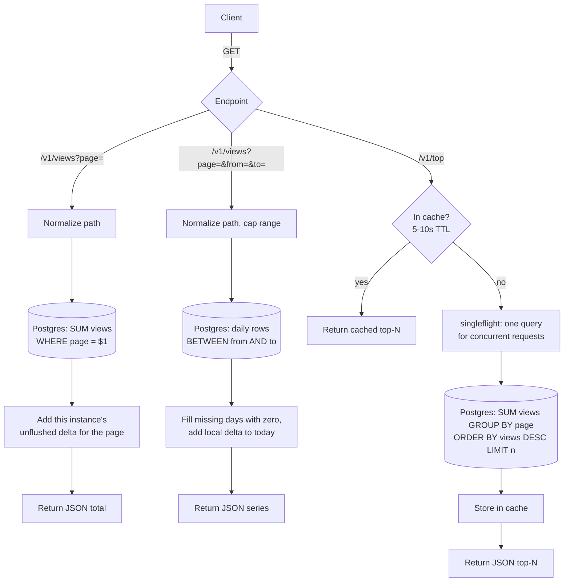

# Page view counter: architecture

Design for ~1k hits/sec: a Go API service with sharded in-memory counters, flushed to Postgres every second.

## Write path

```mermaid
flowchart TD
    C[Client] -->|POST /v1/hit| H[HTTP handler]
    H --> V{Valid body?<br/>rate limit ok?}
    V -- no --> E[400 / 429]
    V -- yes --> N[Normalize path<br/>strip query and fragment, cap length]
    N --> D{Dedupe enabled and<br/>seen recently?}
    D -- yes --> R204[204, not counted]
    D -- no --> S[Pick shard by hash of page]
    S --> I[Lock shard, increment counter, unlock]
    I --> R204b[204 No Content]

    subgraph Flusher goroutine, every 1s
        T[Ticker] --> SW[Swap each shard map<br/>for an empty one]
        SW --> M[Merge old maps into one batch]
        M --> CAP{Over per-day<br/>page cap?}
        CAP -- yes --> OT[Fold new pages into __other__]
        CAP -- no --> TX
        OT --> TX[One transaction:<br/>upsert views = views + delta]
        TX --> OK{Success?}
        OK -- yes --> DONE[Done]
        OK -- no --> RB[Re-merge into next batch<br/>drop over memory cap, count dropped_hits]
    end

    I -.-> SW
    TX --> PG[(Postgres<br/>page_views: page, day, views)]

    SIG[SIGTERM] --> STOP[Stop accepting, drain] --> FF[Final flush] --> EXIT[Exit]
```

## Read path



Reads use a separate connection pool from the flusher, with a statement timeout of about 2s, so a slow dashboard query can't block writes.
