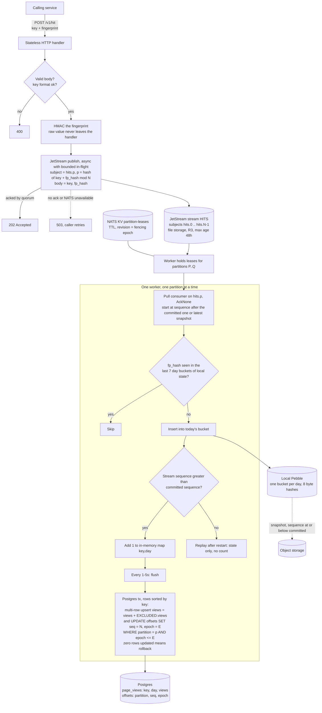

# High-scale design (~100k hits/sec)

An alternative to the ~1k hits/sec design in [write-path.md](write-path.md) and [read-path.md](read-path.md). Use it when one Redis node or the per-hit Redis round trips stop being enough. The 7-day per-viewer dedupe rule and the `key` + `fingerprint` request body are unchanged.

Assumed targets: 100k hits/sec sustained, bursts to 3x, 7-day dedupe window, counts visible within about 10 seconds.

## Principle

Move every per-hit decision off shared state. Hits go onto a partitioned NATS JetStream stream. Each partition has exactly one worker at a time, and that worker owns the dedupe state for its partition locally. Nothing on the write path is shared between workers except Postgres, and that only once per flush interval.

## Write path

### Decisions

- **Partition by hash of key and fingerprint, not by key alone.** Dedupe needs the same (key, fingerprint) pair to reach the same worker, and this guarantees it. A viral video's hits spread evenly across all partitions instead of overloading one worker. Counts commute, so several workers upserting the same `(key, day)` row is correct. It costs a few short row locks per flush on hot rows. The handler computes the partition itself and publishes to `hits.
`.
- **Ingest is asynchronous.** The handler returns 202 once JetStream has acked the publish (replicated to a quorum with R3). The caller no longer learns whether a hit was counted or a duplicate. Handlers are stateless and scale horizontally.
- **Postgres owns the consumer position, not NATS.** Workers read with a pull consumer that does no acking (`AckNone`), starting at an explicit stream sequence. The committed sequence per partition lives in the `offsets` table and moves in the same transaction as the counts. Stream retention is therefore plain limits (max age, max bytes), never ack-based. Sequences are stream-wide rather than per-subject, but they still increase within a partition, which is all the replay filter needs.
- **Partition ownership uses leases in a NATS KV bucket.** JetStream has no automatic consumer-group rebalancing for this pattern, so each worker claims partition leases with a create-or-compare-and-set on the KV key, refreshes them well inside the TTL, and releases excess leases when the worker count changes. The KV revision at claim time is the fencing epoch. A zombie worker whose lease expired fails the `WHERE epoch <= E` check on its next flush, its transaction rolls back, and it stops. The lease TTL needs to be several times the refresh interval. Check this against the NATS version you deploy, since newer releases add built-in partitioned consumer features.
- **Dedupe state is local to the worker, with no Redis.** The store is an embedded [Pebble](https://github.com/cockroachdb/pebble) LSM database (pure Go, no cgo), chosen because about 7.5 GB of hashes per worker does not fit comfortably in memory and the access pattern is one existence check and one insert per hit. Each entry is an 8-byte hash of (key, fp_hash). State is bucketed by day with a key prefix, and expiry is a range delete of the oldest bucket, so there are no per-entry TTLs. Snapshots use Pebble checkpoints, which hard-link the immutable files. A hit is a duplicate if it appears in any of the last 7 buckets, which makes the window 7 to 8 calendar days from the first view.
- **Exactly-once counting without a batch table.** On restart a worker restores its latest state snapshot, reads the committed sequence from Postgres, replays from the snapshot's sequence, and only adds to counts for sequences above the committed one.
- **Snapshots are taken only at sequences at or below the committed sequence.** A snapshot ahead of the commit would hold dedupe entries for hits that were never counted, and replay would then skip them and lose those views.
- **Optional publish-level dedupe:** setting `Nats-Msg-Id` to the hash of (key, fp_hash) makes the stream drop repeats inside its duplicate window (2 minutes by default). It trims load from retry storms but is not relied on for correctness.
- **Day** comes from the JetStream message timestamp (set by the server at ingest), not the worker's clock, so a replay lands in the same day.
- **Postgres load scales with distinct (key, day) rows per flush, not with hits.** A viral key is one row update per worker per flush. Sort rows by key in each transaction to avoid deadlocks. Partition `page_views` by day so old days can be archived and dropped.
- **Cardinality cap:** enforced at flush time in the database as before, with overflow counted under `__other__`.
- **Privacy:** the fingerprint is HMAC'd in the handler before it is published. The stream and the dedupe state only ever hold hashes.

### NATS setup

- 3-node JetStream cluster, stream `HITS` with replicas 3, file storage, subjects `hits.0` through `hits.N-1`, max age 48h (it only has to cover the snapshot interval plus the longest outage you tolerate), and a max-bytes safety limit.
- A single stream is one Raft group, so one leader handles all its writes. If that saturates, split into several streams (for example `HITS_0` to `HITS_3`, each covering a range of partitions). The handler already computes the partition, so this only changes the subject-to-stream mapping.
- Acked writes are replicated to a quorum but not necessarily fsynced at once. JetStream syncs to disk on an interval (`sync_interval`, two minutes by default in current releases). A simultaneous power loss of a quorum could lose recently acked hits, so check the setting for your version and set it to `always` if that risk is not acceptable, at a throughput cost.
- Publish with `PublishAsync` and a bounded number of unacked messages per handler. Do not wait for each ack serially.

### Capacity at 100k hits/sec

| Resource | Estimate |
|---|---|
| NATS traffic | about 60 bytes per hit, so about 6 MB/s on the wire, times 3 for replication. Retention of 48h is about 1 TB per replica set at that rate, so size disks accordingly or shorten retention. |
| Partitions | 64 to start, so about 1.6k hits/sec per partition. Pick the count up front: changing it changes which worker owns a fingerprint. |
| Dedupe state | 8 bytes times 100k/s times 7 days is about 480 GB in total, or about 7.5 GB per worker at 64 workers, on local NVMe. |
| Postgres writes | at most workers times distinct keys per flush, per interval. Typically a few thousand rows per second. |
| Redis | not on the write path. |

## Read path

Unchanged in shape from [read-path.md](read-path.md), with three changes:

- Totals and series are cached in Redis as before (cache-aside, short TTL with jitter), and Postgres reads go to a read replica.
- `/v1/top` is no longer an on-demand `GROUP BY` over the whole table. A periodic job computes it from recent days and writes the result to Redis, so the endpoint only reads the cache.
- Counts lag by stream lag plus the flush interval (1-5s) plus the cache TTL.

## Failure modes

| Failure | Effect |
|---|---|
| Handler dies | None, they are stateless. Callers retry on a non-2xx response. |
| One NATS node lost | R3 keeps the stream available. Publishes continue after a leader election. |
| NATS unavailable | Handlers return 503. Nothing is accepted that could be lost. |
| Worker dies | Its leases expire. Another worker claims them, restores the latest snapshot, replays, and counts only from the committed sequence. No loss, no double count. |
| Worker paused, then resumes (zombie) | Its next flush fails the fencing check and rolls back. |
| Postgres down | Workers stop committing and lag grows. Stream retention must outlast the longest tolerated outage. |
| Caller retries after a lost ack | Deduped by the fingerprint check. |
| Worker state lost with no snapshot | Replay from the earliest retained sequence. Dedupe entries older than the retention are lost, so some repeat viewers can be counted again. Alert on this. |

## Monitoring

Per partition: stream last sequence minus committed sequence (the lag). Plus flush duration, age of the committed sequence, lease churn, dedupe state size per worker, snapshot age and sequence, handler 503 rate, and NATS stream storage used against its limit.

## Limits

- Beyond about 1M hits/sec or very high distinct-key counts, move the counts sink from Postgres to a columnar store such as ClickHouse and keep the same stream and workers.
- Exact 7-day dedupe costs about 5 bytes of disk per hit. If that becomes too much, switch to per-key bloom filters and accept a small false-positive rate (an undercount).
- Resizing partitions needs a drained or replayed stream, because it changes which worker owns a fingerprint.
