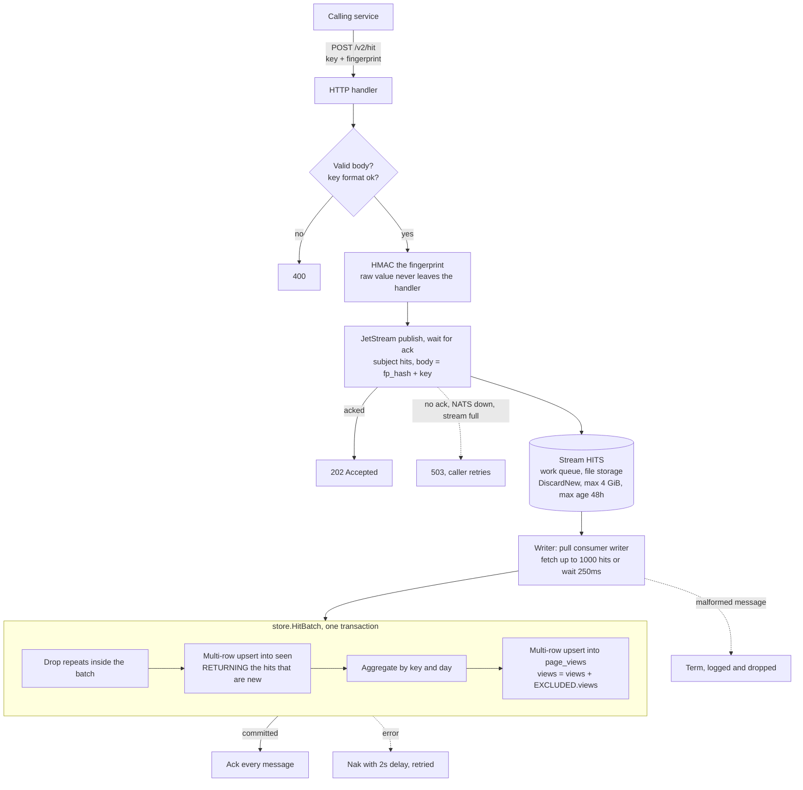
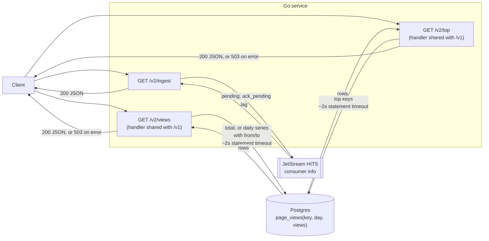
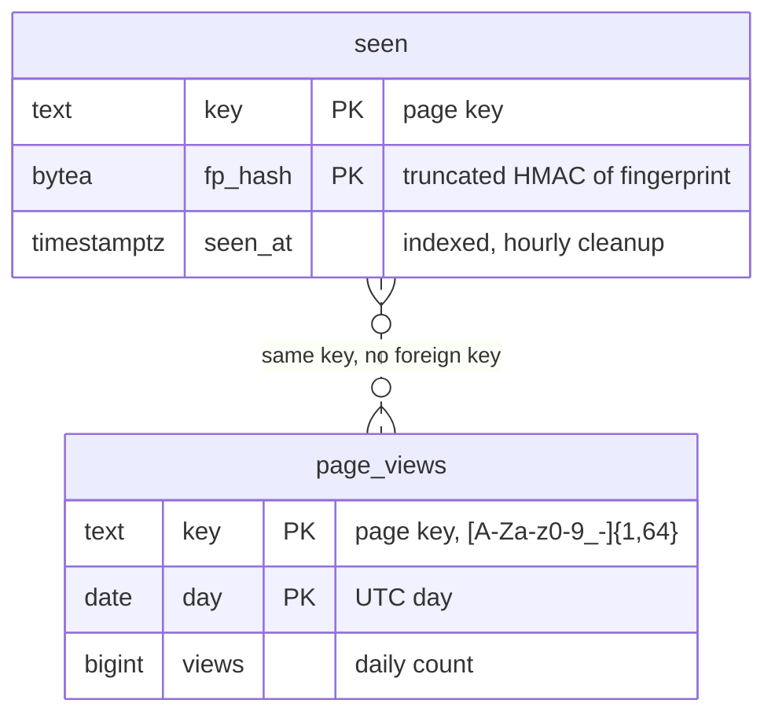
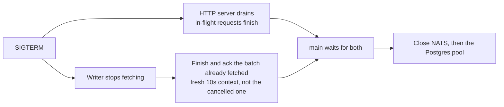

# JetStream write path (`/v2`)

An optional asynchronous write path for when one transaction per hit stops scaling (the Postgres-only design breaks at about 1,000 to 2,000 writes/s, see [postgres-only-benchmark.md](postgres-only-benchmark.md)). Target: 10k writes/s and 10k reads/s. The schema, the dedupe rule (a fingerprint counts once per key per 7 days) and the request body are unchanged from `/v1`.

Status: implemented and covered by tests. **Not load tested.** No throughput number in this document has been measured.

## Design summary

One Go service, one Postgres, plus one NATS server with JetStream. `/v1` keeps working as before. `/v2` is enabled by setting `NATS_URL`; without it only `/v1` routes exist.

| | `/v1/hit` | `/v2/hit` |
|---|---|---|
| Work in the request | One Postgres transaction: dedupe upsert, count upsert | Validate, HMAC, publish to JetStream |
| Success | 204, hit is committed | 202, hit is stored in the stream but **not yet counted** |
| Caller learns if it was a duplicate | No (204 either way) | No (202 either way) |
| Failure | 503 on Postgres error | 503 if the publish is not acked |
| Postgres work | Per hit | Per batch of up to 1000 hits |

## Write path

### Read path and operations

| Endpoint | Behavior |
|---|---|
| `GET /v2/views` | Same handler as `/v1/views`. Reads Postgres directly. |
| `GET /v2/top` | Same handler as `/v1/top`. |
| `GET /v2/ingest` | `{"pending": N, "ack_pending": M}`: hits published but not yet delivered to the writer, and hits delivered but not yet committed. |

Counts lag by the stream backlog plus up to 250ms of fetch wait plus the transaction time. Under normal load that is well under a second. During an outage or a slow Postgres it grows with the backlog; watch `/v2/ingest`.

### Database tables

`/v2` uses the same two tables as `/v1`; the writer touches both in one transaction per batch.

## Design decisions

- **202, not 204.** The hit is durable in the stream but not yet in `page_views`. A read right after a write may not include it.
- **Publish is synchronous per request.** The handler waits for the JetStream ack, so a 202 means the hit is stored. Throughput comes from many requests in flight, not from async publishing.
- **Postgres still owns dedupe.** The `seen` table decides what counts, exactly as in `/v1`. That makes the writer idempotent: a redelivered or replayed hit finds its `(key, fp_hash)` already in `seen` and counts nothing. This is why at-least-once delivery is safe, and why no offsets table or in-process dedupe state is needed. The stream is a durable buffer and nothing more.
- **Batching removes the hot-row problem.** A batch with 800 hits on one key becomes one `+800` update of one `page_views` row instead of 800 updates.
- **Dedupe window uses the hit time.** `HitBatch` takes a timestamp per hit (the JetStream message timestamp, set by the server when the hit was stored). It becomes `seen_at`, and its UTC date becomes the `page_views` day. A backlog drained after an outage lands on the correct day, and a replay does not shift the 7 day window.
- **Row lock order is fixed.** Each batch sorts its `(key, fp)` pairs and its `(key, day)` pairs before the upserts, so several writer instances cannot deadlock each other. Within one statement, repeated pairs are removed first because `ON CONFLICT` cannot touch the same row twice.
- **Work-queue stream.** A message is deleted when acked, so the stream only holds the backlog. `DiscardNew` with a 4 GiB cap means a full stream rejects publishes (503) instead of dropping hits that were never written. Max age is 48h as a safety net.
- **Consumer.** Durable pull consumer `writer`, explicit acks, `AckWait` 30s, `MaxAckPending` 10,000. Multiple service instances share the work through the same durable consumer.
- **Privacy is unchanged.** Only the truncated HMAC (16 bytes) and the key are published. The raw fingerprint never reaches NATS or Postgres.
- **Payload.** 16 bytes of fingerprint hash followed by the key. Both are fixed by validation, so no delimiter or JSON is needed.

## Shutdown

Hits not yet fetched stay in the stream and are picked up on the next start. Nothing is lost on a clean shutdown.

## Failure modes

| Failure | Effect |
|---|---|
| Service crashes mid-batch | The batch was not acked, so after `AckWait` (30s) it is redelivered. `seen` makes the replay count nothing twice. If the transaction had already committed, the replay counts nothing at all. |
| Ack lost after a successful commit | Same as above: redelivered, counted once. |
| Postgres down or slow | The writer naks the batch and retries every 2s. The stream backlog grows and `/v2/ingest` shows it. Publishers keep getting 202 until the stream is full. |
| Stream full (4 GiB) | `/v2/hit` returns 503. Nothing already accepted is dropped. |
| NATS unavailable | `/v2/hit` returns 503. `/v1` and all reads keep working. |
| NATS server loses its disk | Hits in the stream that were not yet counted are lost. See limits. |
| Malformed message in the stream | Terminated (not redelivered) and logged. |
| Caller retries after a lost 202 | The retried hit has the same fingerprint, so `seen` counts it once. |

## Running it

- `docker-compose.yml` has a `nats` service (JetStream on `127.0.0.1:4222`, data in the `natsdata` volume). `mise run db` starts it along with Postgres.
- Start the service with `NATS_URL=nats://localhost:4222 mise run run`.
- Tests start an in-process NATS server (`nats-server` as a test dependency), so `go test ./...` needs Postgres but not NATS or Docker for NATS.
- To drop the backlog and start clean: `docker compose down -v`.

## Tests

- `store`: batch dedupe within and across batches, replay counts nothing, empty batch, day taken from the hit time, 7 day window measured from the hit time, concurrent batches on one hot key count each viewer once.
- `ingest`: published hits reach Postgres once, 2,500 hits published before the writer starts are all counted (more than one batch), lag drains to zero.
- `api`: `/v2/hit` returns 202 and eventually counts, validation returns 400, `/v2/top` and `/v2/ingest` work, `/v2` routes are absent without a queue.

All pass with `-race`. A manual smoke run of the built binary against a standalone NATS server confirmed 202 responses, correct dedupe and a clean SIGTERM.

## Limits and not yet measured

- **No load test.** `loadtest/stress.js` targets `/v1/hit`. Before relying on 10k writes/s, add a path switch to the k6 script, reset the database first, preload a realistic data set, and run k6 from a separate machine (the same gaps listed in the benchmark doc).
- **Single NATS node, one replica.** For durability across node loss run a 3 node cluster and set `Replicas: 3` on the stream. Acked writes are replicated to a quorum but not necessarily fsynced at once; check JetStream's `sync_interval` for your version if a simultaneous power loss is a concern.
- **One stream is one Raft group** on a cluster, so one leader takes all publishes. If that saturates, split into several streams by hash of the key.
- **Single writer loop per instance.** One goroutine fetches and writes batches. If Postgres, not the loop, is the limit, add instances. If the loop is the limit, run more consumers on the same durable consumer.
- **Reads are unchanged.** 10k reads/s is not addressed by `/v2`. See the read-path options in the scaling discussion: an in-process cache with `singleflight`, a precomputed top-N, and a `page_totals` table. None of these are implemented.
- **Callers cannot tell a duplicate from a counted hit.** Both return 202.
- **Dropped on a bad message.** A malformed message is terminated, not dead-lettered.
