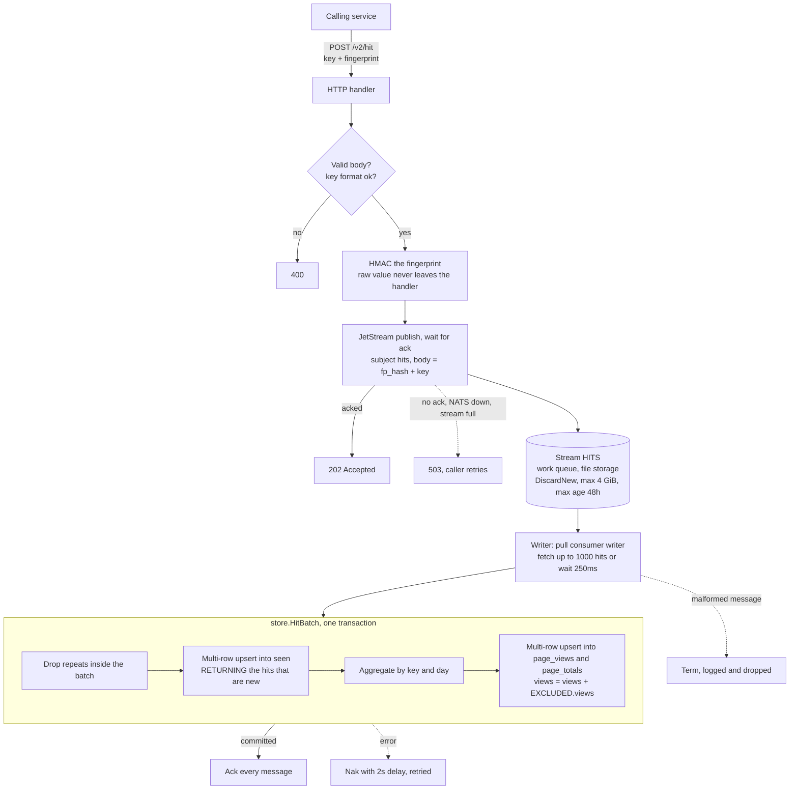
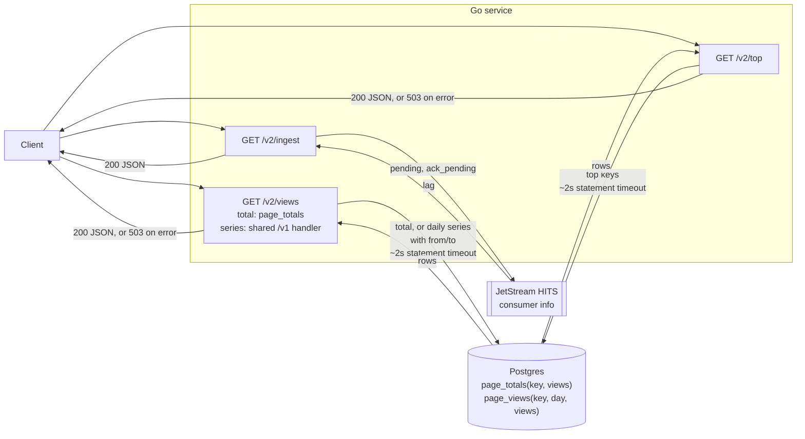
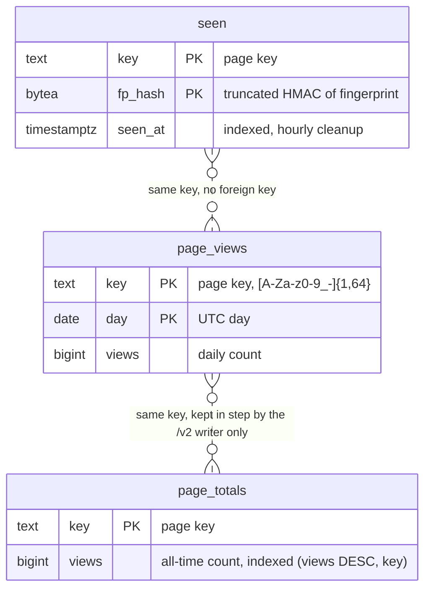
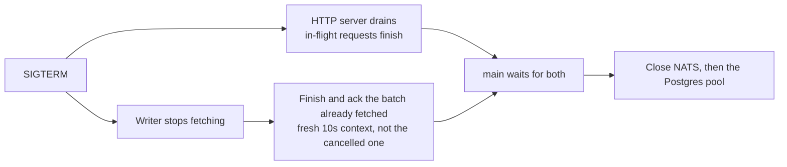

# JetStream write path (`/v2`)

An optional asynchronous write path for when one transaction per hit stops scaling (the Postgres-only design breaks at about 1,000 to 2,000 writes/s, see [postgres-direct-v1.md](postgres-direct-v1.md)). Target: 10k writes/s and 10k reads/s. The schema, the dedupe rule (a fingerprint counts once per key per 7 days) and the request body are unchanged from `/v1`.

Status: implemented and covered by tests. **Not load tested.** No throughput number in this document has been measured.

## Design summary

One Go service, one Postgres, plus one NATS server with JetStream. `/v1` keeps working as before. `/v2` is enabled by setting `NATS_URL`; without it only `/v1` routes exist.

| | `/v1/hit` | `/v2/hit` |
|---|---|---|
| Work in the request | One Postgres transaction: dedupe upsert, count upsert | Validate, HMAC, publish to JetStream |
| Success | 204, hit is committed | 202, hit is stored in the stream but **not yet counted** |
| Caller learns if it was a duplicate | No (204 either way) | No (202 either way) |
| Failure | 503 on Postgres error | 503 if the publish is not acked |
| Postgres work | Per hit | Per batch of up to 1000 hits |

## Write path

### Read path and operations

| Endpoint | Behavior |
|---|---|
| `GET /v2/views` | A total is a single-row read of `page_totals`. A daily series (`from`/`to`) uses the `/v1` handler and reads `page_views`. |
| `GET /v2/top` | Top keys from `page_totals` through its `(views DESC, key)` index. |
| `GET /v2/ingest` | `{"pending": N, "ack_pending": M}`: hits published but not yet delivered to the writer, and hits delivered but not yet committed. |

Counts lag by the stream backlog plus up to 250ms of fetch wait plus the transaction time. Under normal load that is well under a second. During an outage or a slow Postgres it grows with the backlog; watch `/v2/ingest`.

### Database tables

`/v2` uses the same `seen` and `page_views` tables as `/v1` plus `page_totals`. The writer touches all three in one transaction per batch. `/v1` never reads or writes `page_totals`, so hits counted through `/v1` are not in it.

## Design decisions

- **202, not 204.** The hit is durable in the stream but not yet in `page_views`. A read right after a write may not include it.
- **Publish is synchronous per request.** The handler waits for the JetStream ack, so a 202 means the hit is stored. Throughput comes from many requests in flight, not from async publishing.
- **Postgres still owns dedupe.** The `seen` table decides what counts, exactly as in `/v1`. That makes the writer idempotent: a redelivered or replayed hit finds its `(key, fp_hash)` already in `seen` and counts nothing. This is why at-least-once delivery is safe, and why no offsets table or in-process dedupe state is needed. The stream is a durable buffer and nothing more.
- **Batching removes the hot-row problem.** A batch with 800 hits on one key becomes one `+800` update of one `page_views` row instead of 800 updates.
- **Dedupe window uses the hit time.** `HitBatch` takes a timestamp per hit (the JetStream message timestamp, set by the server when the hit was stored). It becomes `seen_at`, and its UTC date becomes the `page_views` day. A backlog drained after an outage lands on the correct day, and a replay does not shift the 7 day window.
- **Row lock order is fixed.** Each batch sorts its `(key, fp)` pairs and its `(key, day)` pairs before the upserts, so several writer instances cannot deadlock each other. Within one statement, repeated pairs are removed first because `ON CONFLICT` cannot touch the same row twice.
- **Work-queue stream.** A message is deleted when acked, so the stream only holds the backlog. `DiscardNew` with a 4 GiB cap means a full stream rejects publishes (503) instead of dropping hits that were never written. Max age is 48h as a safety net.
- **Consumer.** Durable pull consumer `writer`, explicit acks, `AckWait` 30s, `MaxAckPending` 10,000. Multiple service instances share the work through the same durable consumer.
- **Privacy is unchanged.** Only the truncated HMAC (16 bytes) and the key are published. The raw fingerprint never reaches NATS or Postgres.
- **Payload.** 16 bytes of fingerprint hash followed by the key. Both are fixed by validation, so no delimiter or JSON is needed.

## Shutdown

Hits not yet fetched stay in the stream and are picked up on the next start. Nothing is lost on a clean shutdown.

## Failure modes

| Failure | Effect |
|---|---|
| Service crashes mid-batch | The batch was not acked, so after `AckWait` (30s) it is redelivered. `seen` makes the replay count nothing twice. If the transaction had already committed, the replay counts nothing at all. |
| Ack lost after a successful commit | Same as above: redelivered, counted once. |
| Postgres down or slow | The writer naks the batch and retries every 2s. The stream backlog grows and `/v2/ingest` shows it. Publishers keep getting 202 until the stream is full. |
| Stream full (4 GiB) | `/v2/hit` returns 503. Nothing already accepted is dropped. |
| NATS unavailable | `/v2/hit` returns 503. `/v1` and all reads keep working. |
| NATS server loses its disk | Hits in the stream that were not yet counted are lost. See limits. |
| Malformed message in the stream | Terminated (not redelivered) and logged. |
| Caller retries after a lost 202 | The retried hit has the same fingerprint, so `seen` counts it once. |

## Running it

- `docker-compose.yml` has a `nats` service (JetStream on `127.0.0.1:4222`, data in the `natsdata` volume). `mise run db` starts it along with Postgres.
- Start the service with `NATS_URL=nats://localhost:4222 mise run run`.
- Tests start an in-process NATS server (`nats-server` as a test dependency), so `go test ./...` needs Postgres but not NATS or Docker for NATS.
- To drop the backlog and start clean: `docker compose down -v`.

## Tests

- `store`: batch dedupe within and across batches, replay counts nothing, empty batch, day taken from the hit time, 7 day window measured from the hit time, concurrent batches on one hot key count each viewer once.
- `ingest`: published hits reach Postgres once, 2,500 hits published before the writer starts are all counted (more than one batch), lag drains to zero.
- `api`: `/v2/hit` returns 202 and eventually counts, validation returns 400, `/v2/top` and `/v2/ingest` work, `/v2` routes are absent without a queue.

All pass with `-race`. A manual smoke run of the built binary against a standalone NATS server confirmed 202 responses, correct dedupe and a clean SIGTERM.

## Read load test (`GET /v2/views`)

`mise run stress-views` runs `loadtest/views.js`: six steps of 20s each (5s apart) at a fixed arrival rate, each step reported separately. Mix: 70% total of one hot key, 20% total of a cold key (1000 keys), 10% daily series of the hot key. Setup seeds 1,000 hits on the hot key and 1,000 keys with one hit each through `/v2/hit`, waits for the writer to drain, and checks the hot key's count. Thresholds per step: p95 < 500ms, under 1% failed, under 1% of offered requests dropped. Override with `STEPS`, `STEP_DURATION`, `SEED_KEYS`, `HOT_HITS` and `MAX_VUS`. `STOP_ON_FAIL=1` aborts the run at the first failing step.

| Offered reads/s | p95 | p99 | Failed | Dropped |
|---|---|---|---|---|
| 500 | 0.96ms | 1.1ms | 0 | 0 |
| 1,000 | 0.95ms | 1.1ms | 0 | 0 |
| 2,500 | 0.95ms | 1.4ms | 0 | 0 |
| 5,000 | 0.84ms | 3.8ms | 0 | 0 |
| 7,500 | 2.0ms | 19.8ms | 0 | 0 |
| 10,000 | 14.2ms | 30.0ms | 0 | 0 |

530,030 requests, none failed, none dropped. Every step passed, so the ceiling was not found. Latency starts to climb at 7,500 reads/s and p95 at 10,000 is about 15 times that at 5,000, which is the start of saturation.

This does not prove 10k reads/s in production:

- **Small data set.** 1,000 views on the hot key and 1,000 cold keys. A table with millions of keys and a longer history reads slower.
- **Hot key stays cached.** 70% of requests hit one key, which Postgres keeps in memory.
- **No concurrent writes.** The test ran reads only.
- **Same machine.** k6, the service and Postgres share one host, so the result is contended and not a clean ceiling.
- **Short steps.** 20s each.
- **`/v2/top` not tested.** It is the likelier bottleneck.

Finding the ceiling: `STEPS=20000,30000,50000 STOP_ON_FAIL=1 MAX_VUS=10000 mise run stress-views`. The 20k step failed within 3 seconds. k6 offered 20,000 reads/s but completed about 10,600/s, dropped about a quarter of the offered requests, and p95 rose to 246ms with no failed requests. On this machine the ceiling is therefore about 10 to 11k reads/s. The 30k and 50k steps were never reached. This run does not show whether the service, Postgres or k6 itself is the limit, since all three share the host.

Both runs above were before `page_totals` (`migrations/002_page_totals.sql`). After adding it and applying the migration to the dev database, `STEPS=10000,15000,20000,30000,50000 STOP_ON_FAIL=1 MAX_VUS=10000` gave:

| Offered reads/s | p95 | Failed | Dropped | Result |
|---|---|---|---|---|
| 10,000 | 80ms | 0 | 1,488 (0.7%) | pass |
| 15,000 | 218ms | 0 | 3,966 (over the 3,000 allowed) | fail, run stopped |

The ceiling did not move, and 10k looked slightly worse than the first run (p95 14ms, nothing dropped). The dev database also had 47,711 keys by then, against far fewer in the first run, so the two are not directly comparable. `Total` was already a one-row read on the test's hot key, so `page_totals` had nothing to remove here. It should matter for keys with long histories and for `/v2/top`, neither of which this test exercises. The limit is more likely per-request overhead, the connection pool or k6 sharing the host.

## Write load test (`POST /v2/hit`)

`mise run stress-hit-v2` runs `loadtest/hit_v2.js`: steps of 20s each (5s apart) at a fixed arrival rate, each reported separately. 70% of hits go to one hot key and the rest spread over 1,000 keys; every fingerprint is unique, so every hit is a new viewer. Thresholds per step: p95 < 500ms, under 1% failed, under 1% of offered requests dropped. Teardown waits for the writer to drain and logs the hot key's count in Postgres, which should equal `acked_hot_hits`. Override with `STEPS`, `STEP_DURATION`, `SEED_KEYS`, `MAX_VUS`; `STOP_ON_FAIL=1` aborts at the first failing step.

| Offered writes/s | p95 | p99 | Failed | Dropped | Result |
|---|---|---|---|---|---|
| 200 | 1.37ms | 1.7ms | 0 | 0 | pass |
| 500 | 1.33ms | 2.0ms | 0 | 0 | pass |
| 1,000 | 1.37ms | 2.4ms | 0 | 0 | pass |
| 2,000 | 1.56ms | 3.3ms | 0 | 0 | pass |
| 4,000 | 2.35ms | 7.0ms | 0 | 0 | pass |
| 10,000 | 40.9ms | 78.9ms | 0 | 228 (0.1%) | pass |
| 15,000 | 98.3ms | 141ms | 0 | 13,960 (4.7%) | fail |

The first five rows are one run (154,005 hits); the last two are a separate run with `STEPS=10000,15000 MAX_VUS=10000` (485,824 hits). In both, every acked hit was counted: `page_totals` matched the acked totals exactly and the writer lag was 0 after the drain wait.

At 15k, k6 completed about 14,300 requests/s of the 15,000 offered; the step failed only on dropped iterations, with no failed requests. The service ceiling is therefore above 10k writes/s on this machine, and the run does not show whether the service, NATS or k6 is the limit, since all share the host. Latency started to climb between 4k and 10k. Writer lag during the run was not sampled, only after it.

## Limits and not yet measured

- **Write load tested only briefly.** See the write load test above: 10k writes/s passed on a small data set, same-host k6, 20s steps, and unique fingerprints only (no duplicates). Not covered: a realistic preloaded data set, a separate load machine, long runs (the hourly `seen` cleanup and backlog growth), and writer lag sampled during the run.
- **Single NATS node, one replica.** For durability across node loss run a 3 node cluster and set `Replicas: 3` on the stream. Acked writes are replicated to a quorum but not necessarily fsynced at once; check JetStream's `sync_interval` for your version if a simultaneous power loss is a concern.
- **One stream is one Raft group** on a cluster, so one leader takes all publishes. If that saturates, split into several streams by hash of the key.
- **Single writer loop per instance.** One goroutine fetches and writes batches. If Postgres, not the loop, is the limit, add instances. If the loop is the limit, run more consumers on the same durable consumer.
- **Read capacity is unchanged.** `/v2` does nothing for read capacity. `GET /v2/views` held 10k reads/s in the load test above, but on a small data set with a hot key and no concurrent writes, and `/v2/top` was not tested. `page_totals` (all-time sum per key, updated by the `/v2` writer in its transaction) now serves `/v2` totals and top, but it did not move the ceiling: with the small test data, `Total` was already a one-row read. The other option, an in-process cache with `singleflight`, is not implemented.
- **Callers cannot tell a duplicate from a counted hit.** Both return 202.
- **Dropped on a bad message.** A malformed message is terminated, not dead-lettered.
