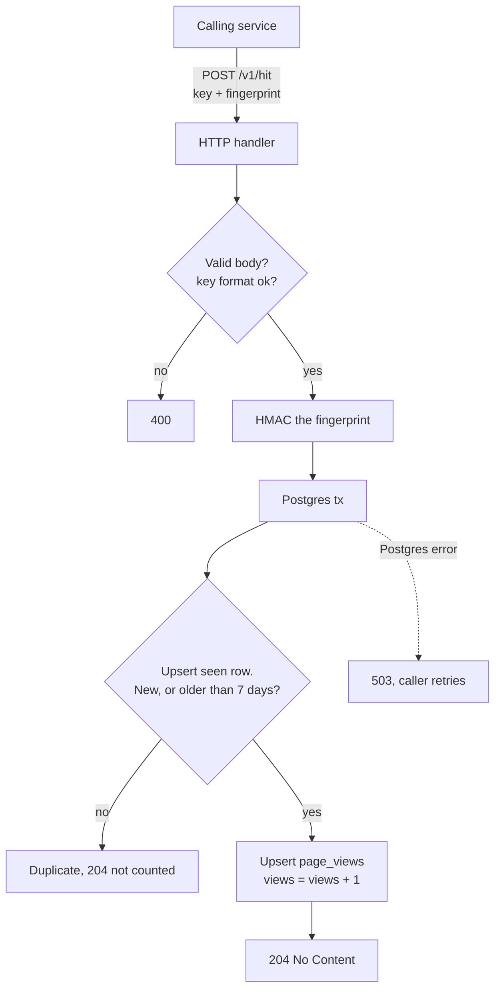
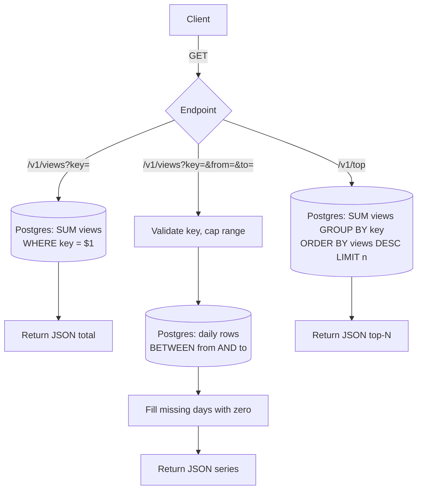
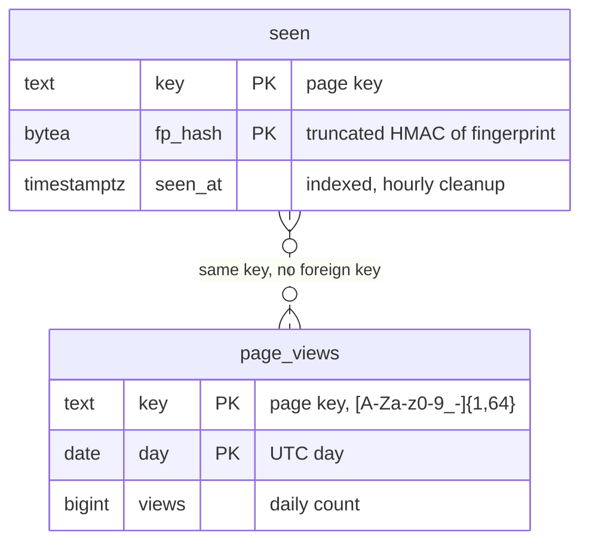

# Postgres-only design: architecture and stress test results

Reference snapshot of the Postgres-only implementation (commit `b2c6dc2`), recorded so later scaling strategies can be compared against it.

## Design summary

One Go service and one Postgres 17. No cache, queue or in-memory state.

### Write path



### Read path



### Summary

| | Write: `POST /v1/hit` | Read: `GET /v1/views`, `GET /v1/top` |
|---|---|---|
| Work per request | 1 transaction: dedupe upsert into `seen`, then upsert into `page_views` (`views = views + 1`) | 1 query straight to Postgres (`SUM` by key, daily rows, or `GROUP BY` for top-N) |
| Dedupe | Fingerprint counts once per key per 7 days (HMAC-SHA256, truncated to 16 bytes) | n/a |
| Timeout | 5s | 2s |
| Failure | 503 on Postgres error, nothing lost | 503 / timeout |

- Schema: `page_views(key, day, views)` PK `(key, day)`; `seen(key, fp_hash, seen_at)` PK `(key, fp_hash)`.
- Hourly goroutine deletes `seen` rows older than 7 days.
- DB access is `pgxpool` with default settings (max conns = max(4, NumCPU) = 12 on the test machine). Postgres runs with default config from the stock `postgres:17` image.
- Sized for ~1 write/s and ~1 read/s. Anything beyond that is headroom.

### Database tables



Both tables are created by `migrations/001_init.sql`. The relationship is logical only: `seen` decides whether a hit counts, `page_views` holds the counts.

## Design decisions

### Write path

- **Single Postgres is the only state.** The Go process keeps nothing in memory, so it can be restarted freely. At 1 hit/sec a transaction per hit is trivial load; batching, caching and queues would add failure modes for no benefit.
- **Dedupe in Postgres.** `seen(key, fp_hash, seen_at, PRIMARY KEY (key, fp_hash))`. One statement decides whether the hit counts:

  ```sql
  INSERT INTO seen (key, fp_hash, seen_at) VALUES ($1, $2, now())
  ON CONFLICT (key, fp_hash) DO UPDATE SET seen_at = now()
    WHERE seen.seen_at < now() - interval '7 days'
  RETURNING 1;
  ```

  A returned row means count it. No row means a duplicate inside the window, which does not extend the window.
- **Counting.** In the same transaction: `INSERT INTO page_views (key, day, views) VALUES ($1, current_date, 1) ON CONFLICT (key, day) DO UPDATE SET views = page_views.views + 1`. Dedupe and count commit together, so a failed hit leaves no trace and the caller's retry counts.
- **Storage:** `page_views(key text, day date, views bigint, PRIMARY KEY (key, day))`, daily buckets, total views only.
- **Cleanup:** a goroutine deletes `seen` rows older than 7 days once an hour. It is the only background job.
- **Failure handling:** if Postgres is down the handler returns 503. Nothing is accepted that could be lost.
- **Shutdown:** on `SIGTERM`, stop accepting and finish in-flight requests.
- **Privacy:** the fingerprint is HMAC-SHA256'd with a server secret and truncated to 16 bytes before it reaches Postgres. The raw value is never logged or stored. Rotating the secret resets dedupe.
- **Trust:** the caller is a trusted internal service, so the fingerprint is taken as given and there is no rate limiting. How the caller authenticates is out of scope.
- **Keys** are validated against `[A-Za-z0-9_-]{1,64}` (a Shorts id is 11 characters).

### Read path

- **No cache.** At 1 read/sec every request can hit Postgres. Counts are exact as of the last committed hit.
- **Statement timeout of ~2s** on read queries, so a slow query can't pile up connections.
- **`/v1/top`** is a plain `GROUP BY` over `page_views`. Cap `n` (for example 100). If the table grows large, restrict it to recent days.
- **Keys** are validated the same way as on the write path.

### Outgrowing this

If hits climb past a few hundred per second, put an in-memory or Redis batching layer in front of the same tables. The schema does not change.

## Test environment

Everything on one machine, so numbers include no real network latency and k6, the service and Postgres compete for CPU.

- Linux 6.18, 12 cores, 30 GB RAM
- Go 1.25.0, k6 2.3.0, Postgres 17 in Docker (`docker-compose.yml`, host port 5433)
- Fresh service process per run (`loadtest/run.sh`); database was not reset between runs
- Run date: 2026-10-20

## Results

The stress test is the target scenario for comparisons.

### Stress test, ramp to 200 writes/s and 50 reads/s (`mise run stress`)

Ramp (writes; reads use the same shape scaled to 50/s): 1/s for 10s, up to 50 over 20s, up to 100 over 20s, up to 200 over 20s, hold 200 for 30s, down to 0 over 10s. 80% of writes target one hot key, the rest spread over 1000 keys. Reads hit the hot key (total, series) and `/v1/top?n=100`.

| Metric | Value |
|---|---|
| Duration | 110s |
| Requests | 15,048 total (about 12k writes, 3k reads, derived from the ramp shape), 136.8 req/s average |
| Peak rate reached | 200 writes/s + 50 reads/s, held for 30s |
| Failed | 0.00% (0 of 15,048) |
| Dropped iterations | 0 |
| All requests latency | avg 2.93ms, med 2.88ms, p90 3.89ms, p95 4.18ms, max 25.59ms |
| Write latency | avg 3.07ms, med 2.93ms, p90 3.73ms, p95 3.93ms, max 25.59ms |
| Read latency | avg 2.34ms, med 1.96ms, p90 4.32ms, p95 4.49ms, max 14.19ms |
| Peak VUs in use | 2 (of 30 allocated) |
| Thresholds | all passed (write p95 < 250ms, read p95 < 500ms, failed < 1%) |

### Break point: same ramp, higher peak rates

Same script with `MAX_WRITE_RATE=<w> MAX_READ_RATE=<w/4> mise run stress`. k6 allows at most 400 write VUs and 200 read VUs, so "dropped" means the offered rate was not served. The database was not reset between runs, so it grows from run to run (631k `seen` rows after the last run).

| Peak writes/s + reads/s | Requests | Avg req/s | Failed | Dropped | Write p95 | Read p95 | Result |
|---|---|---|---|---|---|---|---|
| 200 + 50 | 15,048 | 137 | 0% | 0 | 3.9ms | 4.5ms | pass |
| 1000 + 250 | 75,050 | 682 | 0% | 0 | 3.7ms | 5.2ms | pass |
| 2000 + 500 | 150,004 | 1,364 | 0% | 35 | 4.3ms | 7.5ms | fail (35 dropped, latency fine) |
| 3000 + 750 | 141,471 | 1,286 | 0% | 83,579 | 377ms | 412ms | fail (write p95, dropped) |
| 4000 + 1000 | 220,200 | 2,002 | 0% | 79,839 | 228ms | 238ms | fail (dropped) |
| 8000 + 2000 | 192,013 | 1,746 | 0% | 408,025 | 318ms | 341ms | fail (write p95, dropped) |

Reading the table:

- **Break point: about 1,000 to 2,000 writes/s with 250 to 500 reads/s on top.** Up to 1000 + 250 the service is clean and latency stays under 6ms. At 2000 + 500 latency is still low but the first requests are dropped. Above that, latency jumps to 230 to 380ms and throughput stops growing.
- **Ceiling: about 1,300 to 2,000 req/s total** (roughly 1,000 to 1,600 writes/s plus a quarter as many reads), whatever rate is offered. The later runs are not monotonic (3000 + 750 served less than 4000 + 1000) because the database grew between runs and k6 was also CPU-bound; treat the ceiling as a range.
- **No errors at any rate.** The service never returned a 5xx; overload shows up as queueing latency and dropped k6 iterations, not failed requests.
- **Postgres is the bottleneck.** During the 3000 + 750 run Postgres used about 830% of 1200% CPU, while the Go service and k6 each used about 65% of one core. The Go process has 12 pooled connections (default).
- k6 shares the machine with the service and Postgres, so the true ceiling with a separate load generator may be somewhat higher.

## What these numbers do and don't say

- The test data set is small (12k to 631k `seen` rows). Read cost of `/v1/top` and `SUM` grows with table size and was not exercised at scale.
- Hot-row contention on `page_views` (80% of writes on one key) was part of every run; its share of the Postgres CPU was not isolated.
- Per-stage latency was not captured for the break-point runs, only whole-run aggregates.

## Gaps to close before comparing against million-scale designs

To make later comparisons meaningful, the same scenario should be run against every implementation, with these additions:

1. Reset the database before each run (`docker compose down -v`) so runs are comparable; the break-point runs above were not reset.
2. Pre-load a realistic data set (for example millions of keys and `seen` rows) before reading, to measure `/v1/top` and `SUM` at size.
3. Run k6 on a separate machine, and Postgres on its own host, to remove CPU contention.
4. Record per-stage latency and Postgres CPU, connections and WAL rate during the run.

Reproduce with `mise run stress`; keep the script unchanged when comparing implementations.
