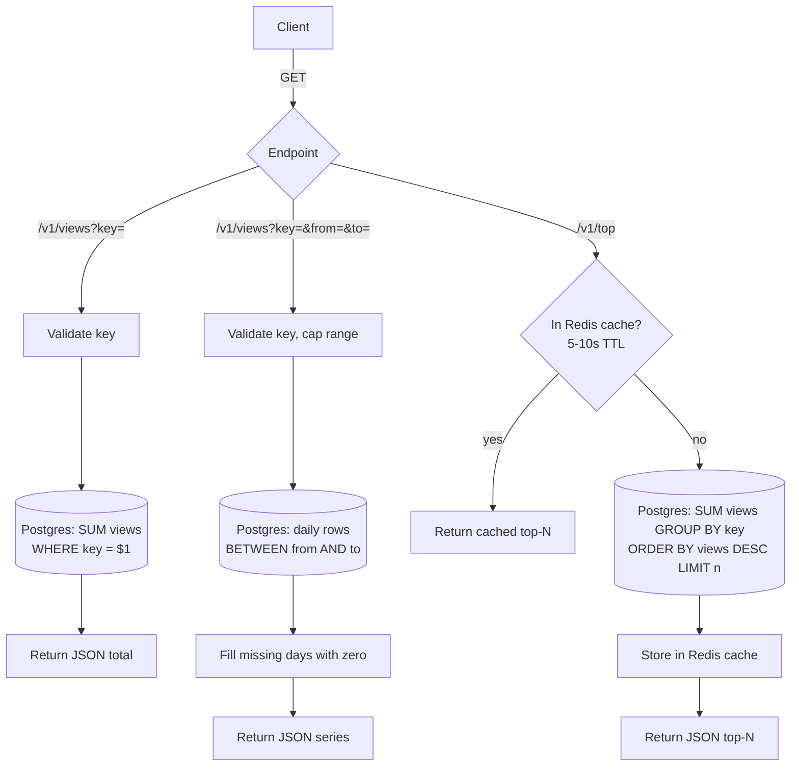

# Read path

Design for ~1k hits/sec: a stateless Go API service. Redis holds the 7-day dedupe state, Postgres holds the counts. The service keeps no keys, fingerprints or counters in its own memory, so any instance can be restarted or scaled freely.

See also [write-path.md](write-path.md).

Counts are exact because every accepted hit is already in Postgres, so there is no local delta to add.

Reads use a separate Postgres connection pool from the write path, with a statement timeout of about 2s, so a slow dashboard query can't block hits. The top-N cache lives in Redis, not the process, to keep the service stateless. Concurrent cache misses on `/v1/top` can each run the query, which is acceptable at this scale.
