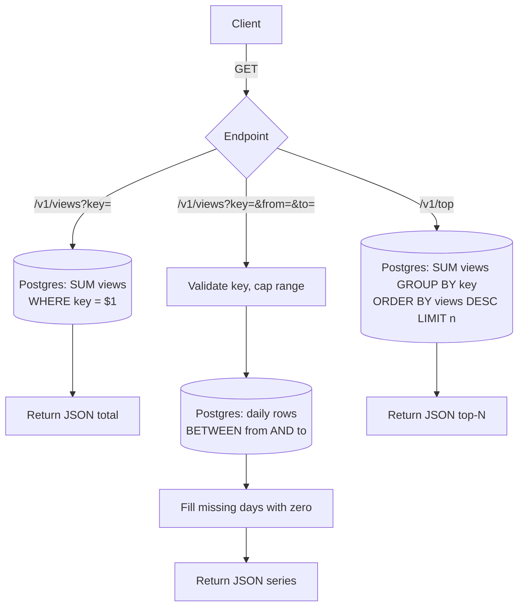

# Read path

Design for ~1 read/sec: the same Go service queries Postgres directly. No cache, so reads are always current.

See also [write-path.md](write-path.md).

## Decisions

- **No cache.** At 1 read/sec every request can hit Postgres. Counts are exact as of the last committed hit.
- **Statement timeout of ~2s** on read queries, so a slow query can't pile up connections.
- **`/v1/top`** is a plain `GROUP BY` over `page_views`. Cap `n` (for example 100). If the table grows large, restrict it to recent days.
- **Keys** are validated the same way as on the write path.
