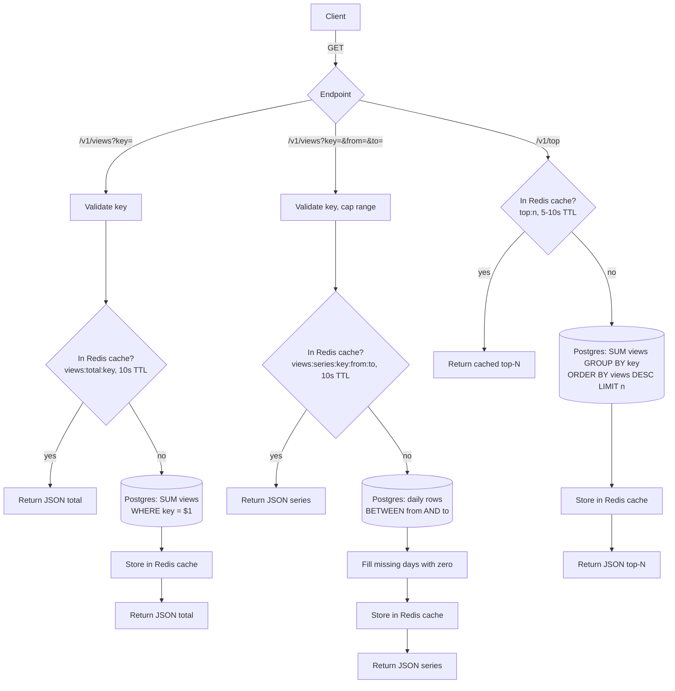

# Read path

Design for ~1k hits/sec: a stateless Go API service. Redis holds the 7-day dedupe state and the read cache, Postgres holds the counts. The service keeps no keys, fingerprints or counters in its own memory, so any instance can be restarted or scaled freely.

See also [write-path.md](write-path.md).

Every accepted hit is already in Postgres, so there is no local delta to add. Reads never aggregate in Postgres on each request: totals, series and top-N are served from the Redis cache, and Postgres is only queried on a miss. Counts can therefore lag by up to the cache TTL.

Reads use a separate Postgres connection pool from the write path, with a statement timeout of about 2s, so a slow dashboard query can't block hits. All caches live in Redis, not the process, to keep the service stateless. Concurrent cache misses on the same cache key can each run the query, which is acceptable at this scale. If Redis is unavailable, reads fall back to querying Postgres directly.
