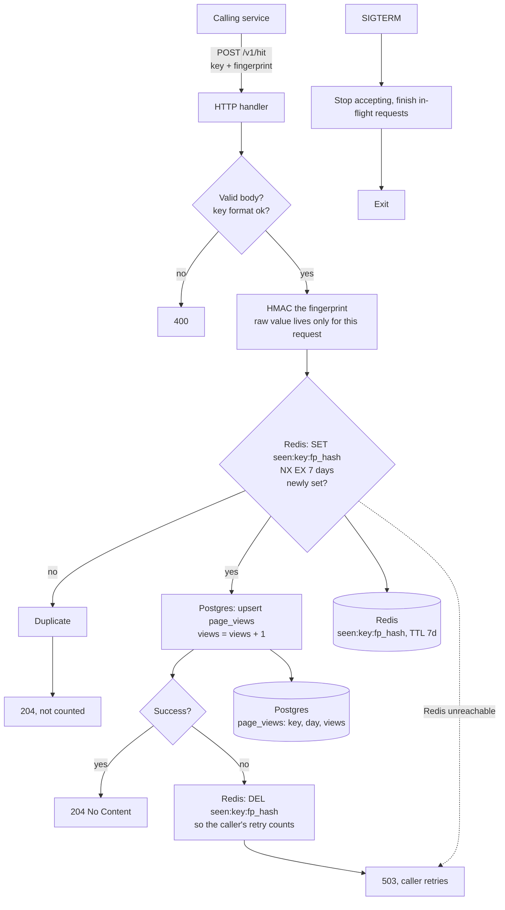

# Write path

Design for ~1k hits/sec: a stateless Go API service. Redis holds the 7-day dedupe state, Postgres holds the counts. The service keeps no keys, fingerprints or counters in its own memory, so any instance can be restarted or scaled freely.

See also [read-path.md](read-path.md).

`POST /v1/hit` is called by another backend service (not browsers) and carries a `key` (a video id, like a YouTube Shorts id) and a `fingerprint` identifying the viewer. A fingerprint counts at most once per key per 7 days.

## Decisions

Marked *agreed* are from the user. The rest are my calls and need confirming.

- **Stateless service** (*agreed*): the Go process stores no keys or fingerprints. There is no flusher, no in-memory counters and no drain step beyond finishing in-flight requests.
- **Redis for dedupe** (*agreed*): `SET seen:{key}:{fp_hash} NX EX 604800`. Expiry is built in, so there is no cleanup job. This overrides the earlier no-Redis decision, which was about counters. Redis does not hold counts.
- **Window:** 7 days from the last counted view for that key and fingerprint. A repeat inside the window does not reset the TTL.
- **Counting:** every accepted hit is written to Postgres before the response, with `INSERT ... ON CONFLICT (key, day) DO UPDATE SET views = page_views.views + 1`. Nothing is lost on a crash, and read totals are exact.
- **Failure handling:** if the Postgres write fails, the service deletes the Redis dedupe key and returns 503, so the caller's retry is counted. If Redis is down the service returns 503 rather than risk counting duplicates. If the process dies between the Redis set and the Postgres write, that one view is lost.
- **Privacy:** the fingerprint is HMAC-SHA256'd with a server secret and truncated to 16 bytes before it reaches Redis. The raw value is never logged or stored. Rotating the secret resets dedupe.
- **Trust:** the caller is a trusted internal service, so the fingerprint is taken as given and there is no per-hit rate limiting. How the caller authenticates is out of scope.
- **Rename:** `page` becomes `key` everywhere. Keys are validated against `[A-Za-z0-9_-]{1,64}` (a Shorts id is 11 characters).

## Risks

- **Hot rows:** a viral key means about 1k writes/sec to one Postgres row, which serializes. If that bites, spread the key over N counter rows and sum on read.
- **Postgres load:** about 1k small upserts/sec, with no batching.
