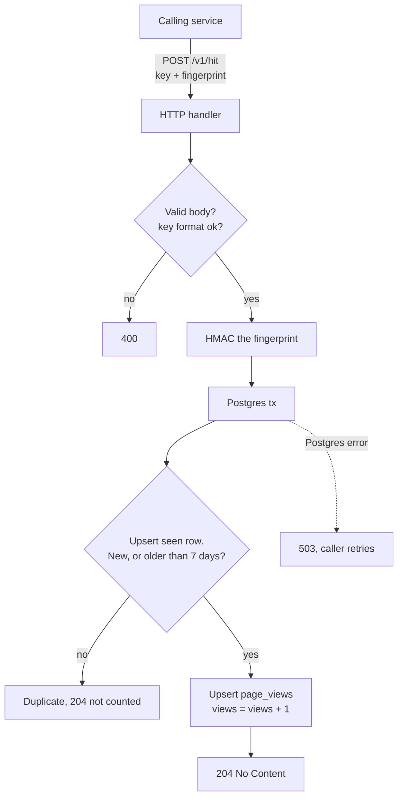

# Write path

Design for ~1 hit/sec: a single Go API service and a single Postgres. No Redis, no queue, no in-memory counters, no batching. Each hit is one small transaction.

See also [read-path.md](read-path.md).

`POST /v1/hit` is called by another backend service (not browsers) and carries a `key` (a video id, like a YouTube Shorts id) and a `fingerprint` identifying the viewer. A fingerprint counts at most once per key per 7 days.



## Decisions

- **Single Postgres is the only state.** The Go process keeps nothing in memory, so it can be restarted freely. At 1 hit/sec a transaction per hit is trivial load; batching, caching and queues would add failure modes for no benefit.
- **Dedupe in Postgres.** `seen(key, fp_hash, seen_at, PRIMARY KEY (key, fp_hash))`. One statement decides whether the hit counts:

  ```sql
  INSERT INTO seen (key, fp_hash, seen_at) VALUES ($1, $2, now())
  ON CONFLICT (key, fp_hash) DO UPDATE SET seen_at = now()
    WHERE seen.seen_at < now() - interval '7 days'
  RETURNING 1;
  ```

  A returned row means count it. No row means a duplicate inside the window, which does not extend the window.
- **Counting.** In the same transaction: `INSERT INTO page_views (key, day, views) VALUES ($1, current_date, 1) ON CONFLICT (key, day) DO UPDATE SET views = page_views.views + 1`. Dedupe and count commit together, so a failed hit leaves no trace and the caller's retry counts.
- **Storage:** `page_views(key text, day date, views bigint, PRIMARY KEY (key, day))`, daily buckets, total views only.
- **Cleanup:** a goroutine deletes `seen` rows older than 7 days once an hour. It is the only background job.
- **Failure handling:** if Postgres is down the handler returns 503. Nothing is accepted that could be lost.
- **Shutdown:** on `SIGTERM`, stop accepting and finish in-flight requests.
- **Privacy:** the fingerprint is HMAC-SHA256'd with a server secret and truncated to 16 bytes before it reaches Postgres. The raw value is never logged or stored. Rotating the secret resets dedupe.
- **Trust:** the caller is a trusted internal service, so the fingerprint is taken as given and there is no rate limiting. How the caller authenticates is out of scope.
- **Keys** are validated against `[A-Za-z0-9_-]{1,64}` (a Shorts id is 11 characters).

## Outgrowing this

If hits climb past a few hundred per second, put an in-memory or Redis batching layer in front of the same tables. The schema does not change.
