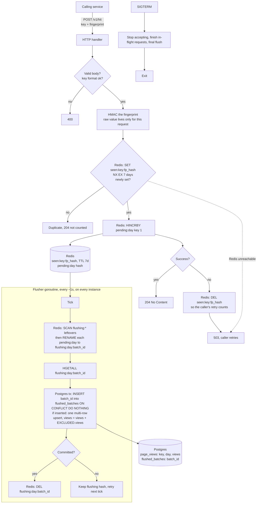

# Write path

Design for ~1k hits/sec: a stateless Go API service. Redis holds the 7-day dedupe state and the pending (unflushed) counts, Postgres holds the durable counts. The service keeps no keys, fingerprints or counters in its own memory, so any instance can be restarted or scaled freely.

See also [read-path.md](read-path.md).

`POST /v1/hit` is called by another backend service (not browsers) and carries a `key` (a video id, like a YouTube Shorts id) and a `fingerprint` identifying the viewer. A fingerprint counts at most once per key per 7 days.

## Decisions

Marked *agreed* are from the user. The rest are my calls and need confirming.

- **Stateless service** (*agreed*): the Go process stores no keys, fingerprints or counters. The flusher holds no state between ticks: everything it needs is in Redis, so it can run on every instance.
- **Redis for dedupe** (*agreed*): `SET seen:{key}:{fp_hash} NX EX 604800`. Expiry is built in, so there is no cleanup job.
- **Window:** 7 days from the last counted view for that key and fingerprint. A repeat inside the window does not reset the TTL.
- **Counting:** the hit handler never touches Postgres and uses no Redis scripts. It runs `SET NX` for dedupe and, only if newly set, `HINCRBY pending:{day} {key} 1`. If the `HINCRBY` fails, it deletes the dedupe key and returns 503 so the caller's retry counts. If the process dies between the two commands, that one view is lost.
- **Batch flush to Postgres** (*agreed*): every ~1s each instance renames `pending:{day}` to `flushing:{day}:{batch_id}` (atomic, so only one instance wins each hash), reads it with `HGETALL`, and writes one Postgres transaction: a multi-row `INSERT ... ON CONFLICT (key, day) DO UPDATE SET views = page_views.views + EXCLUDED.views`. Increments commute, so instances flush independently.
- **Exactly-once flush:** the same transaction inserts `batch_id` into `flushed_batches` (`ON CONFLICT DO NOTHING`) and skips the upsert if the id already exists. The flusher deletes the `flushing:*` hash only after commit. A failed or crashed flush leaves the hash in Redis, and the next tick (on any instance) retries it, so a retry after a lost commit ack cannot double count. Old `flushed_batches` rows are pruned after a few days.
- **Failure handling:** if Redis is down the service returns 503 rather than risk counting duplicates. If Postgres is down, hits keep accumulating in Redis and flush when it returns.
- **Durability:** pending counts exist only in Redis until flushed. Run Redis with AOF `appendfsync everysec`, so a Redis crash loses at most about 1s of hits (a loss of the Redis host without persistence loses up to the flush backlog). A Go process crash loses nothing. On `SIGTERM` the service stops accepting, finishes in-flight requests and does a final flush.
- **Privacy:** the fingerprint is HMAC-SHA256'd with a server secret and truncated to 16 bytes before it reaches Redis. The raw value is never logged or stored. Rotating the secret resets dedupe.
- **Trust:** the caller is a trusted internal service, so the fingerprint is taken as given and there is no per-hit rate limiting. How the caller authenticates is out of scope.
- **Rename:** `page` becomes `key` everywhere. Keys are validated against `[A-Za-z0-9_-]{1,64}` (a Shorts id is 11 characters).

## Risks

- **Hot rows:** batching removes per-hit contention, because a viral key becomes one row update per flush instead of about 1k/sec. No sharded counter rows are needed.
- **Redis memory:** `seen:*` keys dominate (one per distinct key and fingerprint per 7 days), and so does the `pending` hash only if Postgres is down for long. Alert on the age of the oldest `flushing:*` hash.
- **Staleness:** Postgres totals lag by up to the flush interval, and cached reads add the read TTL on top.
